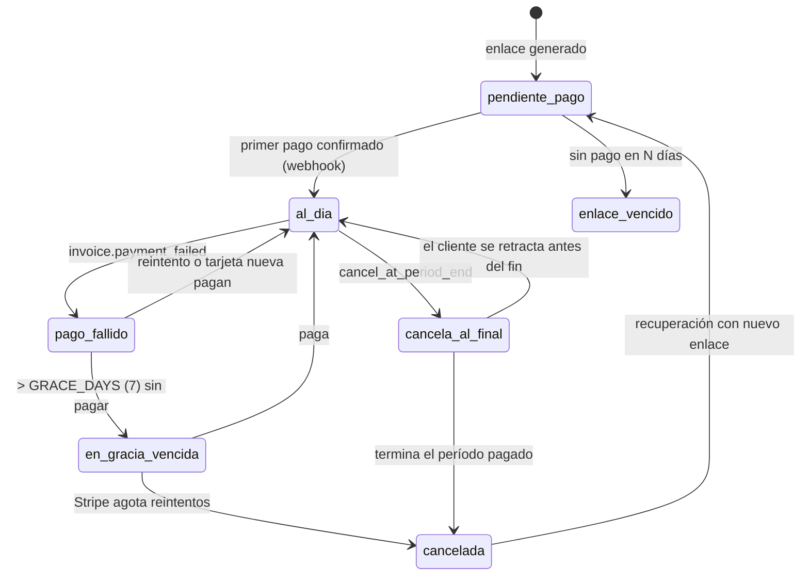

# Pagos y suscripciones del Directorio Empresarial Premium — Fase 1

**Auditoría técnica, arquitectura propuesta y plan de implementación**

| | |
|---|---|
| Proyecto | Cobro recurrente del Perfil Empresarial Premium |
| Propietario | eRadio Global Corp. (El Podcast del Migrante) |
| Fecha | 27 de noviembre de 2026 |
| Estado | **Propuesta para aprobación.** No se ha creado ninguna cuenta, clave, tabla, endpoint ni cobro. No se modificó ningún perfil publicado. |
| Alcance de esta fase | Solo lectura del repositorio y diseño |

> Este documento vive en `docs/`, que **no se publica** en el sitio (`scripts/build-public.mjs` solo copia la lista de permitidos a `dist/`). No contiene claves, identificadores de bases de datos ni datos personales.

---

## 0. Resumen ejecutivo

1. **La infraestructura actual ya tiene casi todo lo que el cobro necesita, salvo Stripe:**
   - una base D1 privada del directorio (`podcastdelmigrante-directorio`) con solicitudes, historial, invitaciones y **membresías por plan** (`FREE`, `PREMIUM_PAID`, `PREMIUM_GIFT`);
   - un panel administrativo protegido con Cloudflare Access;
   - Pages Functions con antispam (Turnstile) y envío de correos (Resend);
   - estadísticas por empresa en una base aparte.
2. **Propuesta:** no crear una arquitectura paralela. Se añaden:
   - **dos Pages Functions nuevas**, en el mismo proyecto que ya atiende `/registro/*`: `/pagos/checkout` y `/pagos/webhook`;
   - **tablas de facturación nuevas** en la misma base D1, con una migración no destructiva, enlazadas a `business_memberships`;
   - **una sección «Facturación»** en el panel existente (`admin-worker`).
3. **Stripe Checkout alojado y el Portal del cliente de Stripe** se encargan de la tarjeta, los impuestos, los recibos, los reintentos y la cancelación. El sitio **nunca** ve ni guarda datos de tarjeta.
4. **Separación de estados:**
   - el **estado editorial** (solicitud y publicación) sigue en `business_applications` y en la miniweb;
   - el **estado de la membresía** sigue en `business_memberships`;
   - el **estado financiero** (suscripción, facturas y pagos) va a tablas nuevas.

   Un impago **nunca** despublica ni borra nada automáticamente.
5. **Las cortesías quedan protegidas en tres niveles:** la regla en el código, un disparador (trigger) en la base de datos y una lista de perfiles protegidos (BIZ-001 a BIZ-005). Así no se puede generar un enlace de pago para una cortesía ni para un perfil fundador o institucional.
6. **Antes de cobrar hay decisiones que no son técnicas** y deben venir de la dirección y de su contador (sección 13): el registro de GST/HST de eRadio Global Corp., las provincias donde corresponde cobrar impuestos, la política de reembolsos y cancelación, y la actualización de los Términos.

### Límite de esta entrega

No pude consultar hoy las páginas oficiales de precios de Stripe, Cloudflare ni la CRA: el acceso de red de esta sesión no las alcanza. El intento de leerlas mediante GitHub Actions fue bloqueado por la política de permisos y **no intenté sortearlo**.

Por eso los **costos de la sección 10** se presentan como **fórmula con valores de referencia marcados «por confirmar»**. Las reglas fiscales de la sección 11 se presentan como **puntos a confirmar con el contador**, no como cifras verificadas. Con autorización para leer esas fuentes, actualizo ambas secciones con fecha de consulta.

---

## 1. Auditoría de la infraestructura actual

### 1.1 Repositorio y publicación (Cloudflare Pages)

| Pieza | Situación verificada en el repositorio |
|---|---|
| Sitio | Estático, generado por scripts (`scripts/build-*.mjs`). Pages publica solo `dist/`, creada por `scripts/build-public.mjs`. |
| Functions | `functions/` se ejecuta solo en las rutas de `_routes.json`: plantillas, `/api/vistas/*`, `/registro/*` y carpetas internas bloqueadas. |
| Registro de empresas | `functions/registro/enviar.js`, `invitacion.js` y `config`. Usa Turnstile, un límite de frecuencia por IP con sal y por correo, idempotencia por `idempotency_key`, R2 privado y correos con Resend. Un interruptor `REGISTRO_ABIERTO="1"` lo abre; por defecto está cerrado. |
| Configuración de Pages | Bindings `DIRECTORIO_DB` (D1) y `SOLICITUDES` (R2). Secretos `RESEND_API_KEY`, `TURNSTILE_SECRET_KEY` e `IP_HASH_SALT`. `functions/_lib/registro-env.js` informa solo nombres de configuración faltante, nunca valores. |
| CI (GitHub Actions) | `registro-empresas.yml` (pruebas unitarias del sitio y del panel), `profile-pages.yml` y `article-pages.yml` (comprueban que lo generado está al día). |
| Perfiles | `js/businesses.js` → `perfil-<slug>.html`, `vcard/<slug>.vcf` y códigos QR (`scripts/build-qr-images.py`). Publicar o cambiar un perfil exige un Pull Request. |

### 1.2 Cloudflare Workers

| Worker | Función | Bases |
|---|---|---|
| `podcastdelmigrante-analytics` | `POST /api/events`: solo acepta los eventos de `ALLOWED_EVENTS` y guarda clics y vistas por empresa. | D1 `podcastdelmigrante-analytics` |
| `podcastdelmigrante-admin` | Panel en `admin.podcastdelmigrante.com`, protegido con Cloudflare Access: verifica el JWT y una lista `ADMIN_EMAILS`, y deniega por defecto. Solo acepta `POST` en rutas de una lista blanca, del mismo origen y en JSON. Envía encabezados de seguridad (CSP, `no-store`, `X-Frame-Options`). | D1 de estadísticas (solo lectura), D1 del directorio y R2 privado |

### 1.3 Base D1 del directorio (`podcastdelmigrante-directorio`)

| Migración | Tablas | Uso para pagos |
|---|---|---|
| `0001_solicitudes.sql` | `business_applications`: estados `pendiente → en_revision → aprobada → publicada`, además de `rechazada` y `duplicada`; `owner_approved`, `business_id` | **Se reutiliza**: es el estado **editorial**. No se modifica. |
| `0002_historial.sql` | `application_events` | Se reutiliza para registrar el pago en el historial de la solicitud. |
| `0003_eliminaciones.sql` | `deletion_requests` | Hay que coordinarla con la obligación de **conservar registros contables** (sección 9.6). |
| `0004_perfil_premium.sql` | Columnas `services`, `notes` y `extra_images` | Sin cambios. |
| `0005_membresias.sql` | `business_invitations` (`FREE`/`PREMIUM_PAID`/`PREMIUM_GIFT`, código guardado solo como SHA-256), `business_memberships` (`en_revision`/`activa`/`suspendida`/`retirada`) y `membership_events` | **Es el punto de enlace natural**: cada suscripción pertenece a una membresía `PREMIUM_PAID`. |

### 1.4 Planes, invitaciones y cortesías

- Página pública `planes-directorio`. Gratuito: $0. Premium: **$24.99 CAD/mes + impuestos**. Hoy dice explícitamente «Todavía no hay pago en línea». Esos textos deben cambiar **solo** después de comprobar un cobro real de extremo a extremo.
- `docs/planes-y-pagos-directorio.md` ya preveía Stripe Billing, un webhook y la lista de decisiones legales previas. Esta propuesta la sigue y la amplía.
- **Cortesías permanentes:** `PREMIUM_GIFT` no vence (`expires_at` vacío) y «ningún proceso automático la cambia». Esa regla se conserva y se refuerza.
- Perfiles publicados en `js/businesses.js`:

| ID | Perfil | Situación | Tratamiento propuesto |
|---|---|---|---|
| BIZ-001 | Tomás Velázquez | Perfil fundador (`foundingProfile: true`) | **Protegido**: sin enlace de pago hasta que la dirección decida por escrito |
| BIZ-002 | Carlos D. Castillo | Perfil fundador | **Protegido**, igual que el anterior |
| BIZ-003 | Santa Latino | Premium de cortesía permanente | **Protegido**: nunca se cobra |
| BIZ-004 | 1JuanRomero1 Inc. | Premium de cortesía permanente | **Protegido**: nunca se cobra |
| BIZ-005 | Nelson Vahos Luxury | Miniweb institucional, fuera del directorio | **Protegido**: nunca se cobra |

### 1.5 Estadísticas, miniwebs, QR y vCards

- Las estadísticas, miniwebs, QR y vCards **no necesitan cambios** para cobrar.
- El estado financiero se mostrará **solo en el panel**, nunca en la miniweb pública.
- Las estadísticas siguen ligadas a `business_id`, sin relación con el pago.

### 1.6 Qué se reutiliza y qué es nuevo

| Se reutiliza | Es nuevo |
|---|---|
| Proyecto de Pages, Functions y `_routes.json` (se añade `/pagos/*`) | `functions/pagos/checkout.js`, `functions/pagos/webhook.js` y `functions/_lib/stripe.js` (firma y llamadas a la API con `fetch`, sin SDK pesado) |
| D1 `podcastdelmigrante-directorio` | Migración `0006_facturacion.sql`, solo con tablas nuevas |
| `business_memberships` (plan `PREMIUM_PAID`) y `membership_events` | Tablas `billing_*` enlazadas por `membership_id` |
| Patrón de invitación: código aleatorio, solo su SHA-256 en la base, `#` en la URL, un solo uso y transacción D1 | **Enlace de pago** de un solo uso con el mismo patrón |
| Panel con Access, `POST` en lista blanca y auditoría por correo verificado | Página `facturacion.html` y rutas `/api/facturacion/*` |
| Correos con Resend (`functions/_lib/correos.js`) | Plantilla «Tu enlace de pago». Stripe envía los recibos y avisos de pago fallido. |
| Pruebas `node --test` y e2e con Playwright | Pruebas de pagos con la API de Stripe en modo de prueba |

---

## 2. Propuesta de integración

**Principio:** Stripe es la fuente de verdad del **dinero** y D1 es la fuente de verdad de **quién es quién**. El panel concilia los dos.

1. **Contratación en dos pasos.** Se cobra **después** de la revisión editorial inicial, para reducir al mínimo las devoluciones.
   1. La empresa envía la solicitud Premium como hoy.
   2. El equipo la revisa.
   3. Si es viable, el panel genera un **enlace de pago de un solo uso**, vinculado a la membresía `PREMIUM_PAID`.
   4. Con ese enlace, el cliente abre **Stripe Checkout** en modo `subscription`, con el precio fijo de 2499 centavos CAD al mes.
2. **Confirmación solo por webhook.** El regreso a la página de éxito **no activa nada**. La suscripción se da por pagada cuando llega `checkout.session.completed` con `payment_status=paid` y `invoice.paid`, con firma verificada.
3. **Publicación sin cambios.** Con el pago confirmado, el equipo prepara la miniweb. El empresario aprueba la vista previa y se publica con un Pull Request, como hoy. **El pago no publica nada automáticamente.**
4. **Renovaciones, recibos, reintentos y cancelación** quedan a cargo de Stripe Billing y del Portal del cliente.
5. **El panel** muestra el estado financiero junto al editorial, permite las acciones administrativas (cancelar al final del período, reembolsar) y exporta informes.

**Alternativa descartada por ahora:** un Payment Link genérico. Es más simple, pero no permite vincular el pago a la solicitud sin trabajo manual ni impedir que pague alguien con cortesía. Puede servir solo como plan de contingencia manual.

---

## 3. Diagrama del flujo de contratación y pagos

```mermaid
sequenceDiagram
    autonumber
    actor E as Empresario
    participant S as Sitio (Pages)
    participant P as Panel (Access)
    participant D as D1 directorio
    participant ST as Stripe

    E->>S: Solicitud Premium (/registro/enviar)
    S->>D: business_applications = pendiente
    P->>D: Revisión editorial → en_revision
    P->>D: «Generar enlace de pago» (solo PREMIUM_PAID, no protegido)
    D-->>P: billing_payment_links (token SHA-256, vence en N días)
    P-->>E: Enlace /pago#t=TOKEN (lo envía el equipo)
    E->>S: Abre el enlace y acepta condiciones visibles
    S->>D: Valida token (pendiente, no vencido, sin suscripción activa)
    S->>ST: Crea Checkout Session (Idempotency-Key = link id)
    ST-->>E: Página de pago alojada por Stripe (precio, impuesto, renovación)
    E->>ST: Paga
    ST->>S: Webhook checkout.session.completed / invoice.paid (firmado)
    S->>D: billing_events (UNIQUE event id) + suscripción activa + factura
    S->>D: application_events «pago confirmado»
    P->>D: Equipo prepara miniweb; empresario aprueba vista previa
    P->>D: Publicada (Pull Request) → membresía activa
    loop Cada mes
        ST->>E: Cobro automático + recibo
        ST->>S: invoice.paid / invoice.payment_failed
        S->>D: Actualiza estado financiero (nunca despublica)
    end
    E->>ST: Portal del cliente: tarjeta, facturas, cancelar al fin del período
    ST->>S: customer.subscription.updated / deleted
```

### Estados financieros

`billing_subscriptions.status` refleja el estado de Stripe. A partir de él, el panel calcula un estado operativo:



**Ningún estado financiero cambia la miniweb por sí solo.** Cuando un estado lo amerita (por ejemplo, gracia vencida o cancelada), el panel muestra la acción sugerida. El cambio público, como pasar a ficha gratuita, sigue siendo manual y con Pull Request, después de hablar con el empresario, igual que hoy con las membresías.

---

## 4. Modelo de datos y migraciones propuestas

### Migración `db/directorio/0006_facturacion.sql`

- Solo `CREATE TABLE` / `INDEX` / `TRIGGER IF NOT EXISTS`. No altera tablas existentes.
- Se aplica **primero en una base D1 de pruebas separada**, `podcastdelmigrante-directorio-test`.
- En producción, solo con autorización y después de un respaldo (`wrangler d1 export`).

| Tabla | Propósito | Campos clave |
|---|---|---|
| `billing_payment_links` | Enlaces de pago de un solo uso | `id` (`PAY-AAAAMMDD-XXXXXX`), `membership_id`, `application_id`, `token_sha256` UNIQUE, `status` (`pendiente`/`usado`/`vencido`/`revocado`), `expires_at`, `checkout_session_id`, `created_by` y `created_at` |
| `billing_customers` | Relación entre la membresía y el cliente de Stripe | `id`, `membership_id` UNIQUE, `stripe_customer_id` UNIQUE, `livemode`, `created_at`. Sin datos de tarjeta; el correo y la dirección viven en Stripe. |
| `billing_subscriptions` | Estado financiero | `stripe_subscription_id` UNIQUE, `membership_id`, `status` (`incomplete`/`active`/`past_due`/`unpaid`/`canceled`…), `cancel_at_period_end`, `current_period_start`/`end`, `first_failed_at`, `price_id`, `livemode`, `stripe_updated` (marca de tiempo del último evento aplicado), `updated_at` |
| `billing_invoices` | Historial de facturas y pagos | `stripe_invoice_id` UNIQUE, `subscription_id`, `number`, `status`, `currency`, `subtotal`, `tax`, `total` y `amount_paid` (en centavos), `tax_breakdown` (JSON por jurisdicción), `hosted_invoice_url`, `paid_at`, `period_start`/`end`, `livemode` |
| `billing_refunds` | Devoluciones | `stripe_refund_id` UNIQUE, `invoice_id`, `amount`, `reason`, `requested_by`, `created_at` |
| `billing_events` | Bitácora de webhooks (idempotencia y auditoría) | `stripe_event_id` UNIQUE, `type`, `livemode`, `created` (de Stripe), `received_at`, `processed_at`, `result` (`aplicado`/`ignorado_duplicado`/`ignorado_antiguo`/`error`), `object_id`. **No se guarda el cuerpo completo**: solo los identificadores necesarios, sin datos personales. |
| `billing_audit` | Acciones humanas de facturación | `at`, `actor` (correo verificado por Access), `action`, `membership_id`, `detail` |
| `billing_settings` | Parámetros configurables | `grace_days` = 7, `link_ttl_days` = 7, `mode` (`test`/`live`) |
| `billing_protected` | Perfiles que nunca se cobran | `business_id` PK, `reason` (`cortesia`/`fundador`/`institucional`), `added_by` y `added_at`. Se carga con BIZ-001 a BIZ-005. |

### Restricciones de integridad (en la base, no solo en el código)

- **Un solo enlace abierto por membresía:** índice único parcial `billing_payment_links(membership_id) WHERE status='pendiente'`.
- **Una sola suscripción vigente por membresía:** índice único parcial `billing_subscriptions(membership_id) WHERE status IN ('incomplete','trialing','active','past_due','unpaid')`.
- **Trigger `trg_no_cobro_cortesia`:** `BEFORE INSERT ON billing_payment_links` → `RAISE(ABORT)` si:
  - la membresía no es `PREMIUM_PAID`;
  - la membresía no está en `en_revision` o `activa`; o
  - su `business_id` está en `billing_protected`.
- **Idempotencia del webhook:** `UNIQUE(stripe_event_id)`. Un evento repetido no cambia nada.

**Reversión:** las tablas nuevas se pueden quitar sin tocar las existentes. Antes, se exporta un respaldo.

---

## 5. Diseño del módulo de facturación del panel

Nueva pestaña **Facturación** en `admin.podcastdelmigrante.com`. Usa la misma autenticación (Access, `ADMIN_EMAILS`), los mismos encabezados y la misma lista blanca de `POST`.

| Vista | Contenido |
|---|---|
| **Resumen** | Suscripciones al día, en pago fallido, en gracia vencida y con cancelación programada; ingresos cobrados del mes (subtotal, impuestos, total y reembolsos); próximos cobros. Muestra **Modo PRUEBA** o **Modo REAL** de forma visible. |
| **Suscripciones** | Una fila por membresía `PREMIUM_PAID`: empresa, BIZ-id, estado editorial, **estado financiero**, próximo cobro, último pago, días en gracia y enlace al cliente en el panel de Stripe. Los filtros siguen las mismas categorías. |
| **Detalle** | Historial cronológico que une los hechos editoriales (`application_events` y `membership_events`) con los financieros (facturas, pagos, reembolsos y auditoría). |
| **Enlaces de pago** | Generar (con confirmación; el enlace se muestra **una sola vez**, como las invitaciones), renovar y revocar. El botón no aparece para cortesías ni perfiles protegidos, y el trigger lo impide igualmente. |
| **Acciones** | Cancelar al final del período, reactivar antes del fin, cancelar de inmediato (exige escribir el ID para confirmar) y reembolsar una factura (total o parcial, con motivo). Todas quedan en `billing_audit`. |
| **Conciliación** | Diferencias entre Stripe y D1 detectadas por la tarea diaria (sección 9.4), con la acción sugerida. |
| **Exportar** | CSV mensual o por rango: número de factura, fecha, cliente (razón social), provincia de facturación, subtotal, impuesto por tipo (GST/HST/QST/PST), total, reembolsos, comisión de Stripe y neto. Un segundo CSV detalla los pagos fallidos y las cancelaciones. |

**Qué no hace el panel:** no muestra ni pide números de tarjeta y no cambia precios; el precio está fijado en Stripe. Las cortesías siguen gestionándose en la pestaña **Invitaciones**, que no cambia.

---

## 6. Eventos de Stripe necesarios

| Evento | Uso |
|---|---|
| `checkout.session.completed` | Vincula el cliente y la suscripción a la membresía (`client_reference_id` = `membership_id`, más `metadata`) y marca el enlace como usado. |
| `checkout.session.expired` | Libera el enlace si el cliente no terminó, para que pueda reintentar con el mismo enlace mientras no venza. |
| `customer.subscription.created` / `updated` / `deleted` | Estado, `cancel_at_period_end`, períodos y cancelaciones. |
| `invoice.finalized` | Registra la factura con su número e impuestos. |
| `invoice.paid` | Pago confirmado, tanto el primero como las renovaciones. |
| `invoice.payment_failed` | Inicio de la gracia: `first_failed_at` y aviso en el panel. |
| `invoice.payment_action_required` | Autenticación 3-D Secure pendiente. Se muestra en el panel; Stripe avisa al cliente. |
| `invoice.upcoming` (opcional) | Previsión del próximo cobro en el resumen. |
| `charge.refunded` | Registra los reembolsos, incluidos los hechos desde el panel de Stripe. |
| `charge.dispute.created` / `charge.dispute.closed` | Disputas o contracargos: alerta en el panel. |

El endpoint de **prueba** y el **real** se registran por separado en Stripe, cada uno con su propio secreto de firma.

---

## 7. Reglas comerciales: cómo se cumplen

| Regla | Mecanismo |
|---|---|
| El plan básico sigue gratis | El flujo Gratuito no cambia y nunca crea enlaces de pago, porque el trigger exige `PREMIUM_PAID`. |
| Cortesías protegidas, sin tarjeta | Las cortesías son `PREMIUM_GIFT` y no tienen enlace de pago. Además, `billing_protected` cubre BIZ-001 a BIZ-005, el trigger lo aplica en la base y hay pruebas automáticas para cada perfil protegido. |
| Aprobación antes de publicar | El pago no publica nada. La publicación sigue siendo un Pull Request con aprobación del empresario. |
| Estado editorial separado del financiero | Hay tablas y columnas distintas, y el panel muestra los dos estados uno junto al otro. |
| No borrar por impago | Ningún proceso automático modifica `js/businesses.js`, las miniwebs ni las estadísticas. |
| Gracia configurable de 7 días | `billing_settings.grace_days`. Stripe reintenta el cobro (Smart Retries) y el panel marca la gracia vencida. |
| Cancelación al final del período | El Portal del cliente se configura así y el panel ofrece la misma acción. |
| Condiciones claras antes del pago | La página `/pago` muestra el precio, la mención «más impuestos aplicables», que la renovación es mensual automática, cómo cancelar y que la publicación requiere aprobación, con casillas de aceptación versionadas (como `CONSENT_VERSION`). Stripe Checkout repite el precio, el impuesto calculado y la renovación. |
| Devolución si no se aprueba (propuesta para decidir) | Si la miniweb no puede publicarse por causas atribuibles a la revisión, se reembolsa el 100% del primer cargo y se cancela la suscripción de inmediato. La decisión se registra en el panel y se avisa al cliente por correo. Plazo propuesto: hasta 30 días después del pago. **Debe aprobarlo la dirección y publicarse en los Términos.** |

---

## 8. Seguridad

1. **Tarjetas:** solo Stripe Checkout y el Portal, alojados por Stripe. El sitio y D1 no reciben datos de tarjeta, lo que reduce el alcance PCI (en Stripe, cuestionario SAQ A; a confirmar en la cuenta).
2. **Secretos:** se cargan con `wrangler pages secret put` / `wrangler secret put`, o desde el panel de Cloudflare, como los secretos actuales. **Nunca** se escriben en el repositorio, el frontend, los registros ni los mensajes. Hay que configurarlos en cada lugar que los usa:

   | Dónde | Secretos |
   |---|---|
   | Pages (producción) | `STRIPE_SECRET_KEY` (clave **restringida**), `STRIPE_WEBHOOK_SECRET` |
   | Pages (vista previa) | Equivalentes **de prueba** |
   | Panel (`admin-worker`) | Clave restringida aparte, solo con los permisos que necesita (suscripciones, reembolsos y lectura) |

   Como ya hace `registro-env.js`, la configuración que falta se informa solo por **nombre**.
3. **Firma de los webhooks:**
   - Se verifica `Stripe-Signature` con HMAC-SHA256 en Web Crypto, comparación en tiempo constante y una tolerancia de 5 minutos.
   - Se rechaza cualquier evento cuyo `livemode` no coincida con el modo configurado.
   - El cuerpo se lee crudo, antes de interpretarlo.
4. **Idempotencia:**
   - **Webhooks:** `UNIQUE(stripe_event_id)`.
   - **Llamadas a Stripe:** cabecera `Idempotency-Key` derivada del ID interno, por ejemplo `checkout-PAY-…`.
   - **Enlaces:** un solo uso, con transacción D1.
5. **Eventos fuera de orden:** no se aplica el cuerpo del evento a ciegas. Se vuelve a leer el objeto actual en la API de Stripe (`GET /v1/subscriptions/{id}`) y solo se aplica si es más reciente que `stripe_updated`. Si el objeto todavía no existe en D1, se crea a partir de la API.
6. **Duplicados de cobro:**
   - antes de crear un Checkout, se comprueba que no haya una suscripción vigente ni otro enlace abierto (índices únicos);
   - se reutiliza el `stripe_customer_id` de la membresía;
   - la sesión de Checkout vence.
7. **Acceso administrativo:** Cloudflare Access, `ADMIN_EMAILS`, `POST` en lista blanca del mismo origen y confirmación explícita en las acciones irreversibles. Todo queda en `billing_audit` con el correo verificado.
8. **Separación entre prueba y real:**

   | | Prueba | Real |
   |---|---|---|
   | Base D1 | `podcastdelmigrante-directorio-test` | `podcastdelmigrante-directorio` |
   | Claves | `sk_test`/`rk_test` | `rk_live` |
   | Endpoints de webhook | Propios | Propios |
   | Columna `livemode` | En cada fila | En cada fila |

   El panel muestra el modo en un banner. Un interruptor `PAGOS_ABIERTOS="1"`, igual que el del registro, mantiene `/pagos/*` cerrado mientras falte configuración.
9. **Registros (logs):** solo IDs de Stripe y nombres de eventos. Nunca correos, tarjetas, claves ni cuerpos completos.
10. **Antiabuso:** el enlace exige su token (24 bytes aleatorios, guardado como SHA-256 y enviado tras `#`). Hay límite de frecuencia por IP con hash, y Turnstile si hiciera falta.

---

## 9. Recuperación y conciliación

1. **Pagos fallidos:** Stripe Smart Retries y correos automáticos de Stripe con el enlace para actualizar la tarjeta. El panel muestra los días en gracia y, al vencer los 7, sugiere hablar con el empresario. **Nunca despublica sola.**
2. **Cancelaciones:** por defecto, al final del período desde el Portal. Recuperar es fácil:
   - **antes del fin:** se reactiva desde el Portal o el panel;
   - **después:** se genera un enlace de pago nuevo para la misma membresía, y se conservan la historia y las estadísticas.
3. **Webhook caído:** Stripe reintenta las entregas automáticamente. La tarea de conciliación detecta lo que falte.
4. **Conciliación diaria:** una tarea programada (Cron Trigger) en `admin-worker`:
   - compara en Stripe las suscripciones y las facturas de los últimos 35 días con D1;
   - corrige lo que falta usando la API como fuente de verdad;
   - lista en el panel lo que requiera decisión humana, por ejemplo un pago sin membresía.
5. **Cierre mensual:**
   - exportar el CSV;
   - compararlo con el informe de saldo y pagos (payouts) de Stripe;
   - archivarlo para la contabilidad.
6. **Conservación de registros:** las facturas y pagos son registros contables con obligaciones de conservación (la CRA exige en general varios años; **plazo a confirmar con el contador**).
   - Una eliminación de datos personales (`deletion_requests`) debe anonimizar la relación con la persona, **sin borrar** las facturas ni los importes.
   - Este procedimiento se documentará junto al de eliminaciones.
7. **Respaldos:** D1 Time Travel y `wrangler d1 export` antes de cada migración.

---

## 10. Estimación de costos (fórmula; valores por confirmar)

**Advertencia:** no pude verificar hoy las páginas oficiales de precios. Los valores siguientes son **referencias por confirmar** en `stripe.com/en-ca/pricing`, la página de precios de Stripe Billing y Stripe Tax, y la de precios de Cloudflare. **No deben tomarse como cifras oficiales** hasta esa verificación.

| Concepto | Fórmula | Valor de referencia (por confirmar) |
|---|---|---|
| Procesamiento de tarjeta nacional | % del cargo + monto fijo | 2.9% + $0.30 CAD |
| Tarjeta internacional o conversión | Recargo adicional | Por confirmar |
| Stripe Billing (suscripciones) | % del volumen facturado | ~0.7% (pago por uso) |
| Stripe Tax (si se usa) | % de cada transacción con impuesto | ~0.5% |
| Disputa o contracargo | Monto fijo por disputa | Por confirmar |
| Reembolsos | La comisión original puede no devolverse | Por confirmar |
| Cloudflare Pages Functions y Workers | Plan actual: los webhooks y el Checkout suman pocas solicitudes al mes | Probablemente cabe en el plan vigente; por confirmar |
| D1 | Pocas filas por cliente al mes | Despreciable; por confirmar |

**Ejemplo por suscripción y mes**, con los valores de referencia y un cliente de Alberta (GST de 5% como supuesto, por confirmar):

- Cargo: $24.99 + $1.25 de impuesto = $26.24.
- Comisión de tarjeta: 2.9% × $26.24 + $0.30 ≈ $1.06.
- Billing: 0.7% × $26.24 ≈ $0.18. Tax: 0.5% × $26.24 ≈ $0.13.
- **Costo total ≈ $1.37 por mes.** El neto antes del impuesto que se remite es ≈ $23.62.
- Con 100 suscriptores ≈ $137 al mes en comisiones.

Las cifras se recalcularán con los valores oficiales y su fecha de consulta.

---

## 11. Impuestos canadienses: lo que debe confirmar el contador

Esta sección **no fija obligaciones**: enumera las decisiones que dependen de la situación fiscal verificada de eRadio Global Corp.

1. **Registro de GST/HST:**
   - ¿Tiene eRadio Global Corp. número de GST/HST? Si no, ¿supera o espera superar el umbral de pequeño proveedor? Es de $30,000 en cuatro trimestres consecutivos; **a confirmar en la CRA**.
   - Sin registro no se debe cobrar el impuesto.
2. **Lugar de suministro:** para un servicio digital prestado a empresas de otras provincias, la tasa suele depender de la provincia del cliente (GST de 5% o la HST de esa provincia). Hay que confirmar:
   - las reglas de lugar de suministro de la CRA para este servicio;
   - si aplica QST de Quebec (registro con Revenu Québec);
   - si aplica PST de Columbia Británica, Saskatchewan o Manitoba a este tipo de servicio.
3. **Herramienta:**
   - **A, recomendada:** Stripe Tax con los registros cargados, para que calcule por la dirección de facturación del cliente.
   - **B:** tasas configuradas a mano en Stripe (Tax Rates) por provincia.
4. **Facturas:** deben llevar razón social, número de GST/HST y, si se excede el umbral de importe de la CRA, los datos del cliente. El número de la empresa se configura en Stripe.
5. **Precio:** $24.99 CAD **más** impuestos, configurado como precio sin impuesto incluido (`tax_behavior=exclusive`), coherente con la página de planes.
6. **Zona horaria contable y cierre:** a confirmar; el panel usa hoy America/Edmonton.

---

## 12. Checklist de pruebas

**Unitarias** (`node --test`, sin red):
- [ ] La firma de webhook válida se acepta; las inválidas, las vencidas (más de 5 minutos) y las de otro modo se rechazan.
- [ ] Un evento duplicado no cambia nada; el resultado queda como `ignorado_duplicado`.
- [ ] Eventos fuera de orden: un `updated` antiguo después de uno nuevo no retrocede el estado.
- [ ] El trigger impide crear un enlace para `PREMIUM_GIFT`, `FREE`, BIZ-001 a BIZ-005 y membresías retiradas.
- [ ] Índices únicos: no se pueden abrir dos enlaces ni tener dos suscripciones vigentes en la misma membresía.
- [ ] Un token de enlace vencido, usado o revocado se rechaza.
- [ ] Los registros nunca contienen correos, tokens ni cuerpos de eventos.
- [ ] El CSV exportado: totales cuadran, separa impuestos y hace el escape correcto.

**Integración** (Stripe en modo de prueba, base D1 de pruebas; con Stripe CLI y Test Clocks):
- [ ] Primer pago con la tarjeta `4242 4242 4242 4242` → la suscripción queda activa y la factura registrada.
- [ ] 3-D Secure (`4000 0025 0000 3155`), rechazo (`4000 0000 0000 9995`) y tarjeta que falla en la renovación.
- [ ] Renovación mensual simulada con Test Clock → `invoice.paid`.
- [ ] Pago fallido → gracia → vencimiento de la gracia sin despublicar → recuperación con tarjeta nueva.
- [ ] Cancelación al final del período, retractación y cancelación efectiva.
- [ ] Reembolso desde el panel y desde el panel de Stripe; los dos se reflejan.
- [ ] Doble clic y dos pestañas → un solo Checkout y un solo cobro.
- [ ] Webhook caído o reintentado → la conciliación diaria lo corrige.
- [ ] Impuesto calculado por provincia según la configuración aprobada.

**End-to-end** (Playwright; celular, tableta y computador):
- [ ] La página `/pago` muestra precio, impuestos, renovación y cancelación, y pide aceptar.
- [ ] El panel muestra las vistas y las acciones de facturación con Access, y deniega sin identidad.
- [ ] No hay regresiones: registro, invitaciones, cortesías, estadísticas, miniwebs, QR y vCards.

**Antes de pasar a cobros reales:** revisión de seguridad del código de pagos, revisión de los textos legales y un **cobro real controlado** (por ejemplo, una suscripción propia, reembolsada después) antes de cambiar los textos públicos.

---

## 13. Plan de implementación por fases

| Fase | Contenido | Requiere |
|---|---|---|
| **0. Decisiones** | Situación de GST/HST y provincias; política de reembolsos y cancelación; gracia de 7 días; tratamiento de BIZ-001 y BIZ-002; texto legal de Premium en `terminos.html`; titular de la cuenta Stripe | Dirección y contador |
| **1. Entorno de pruebas** | Cuenta Stripe en modo de prueba, base D1 de pruebas, migración `0006` en pruebas y secretos de prueba en Pages (vista previa) | Aprobación de este informe |
| **2. Checkout y webhook** | `/pago`, `/pagos/checkout`, `/pagos/webhook`, enlaces de pago y pruebas unitarias e de integración | Fase 1 |
| **3. Panel de facturación** | Vistas, acciones, auditoría y exportación CSV | Fase 2 |
| **4. Recuperación** | Portal del cliente, gracia, cancelaciones, reembolsos y conciliación diaria | Fase 3 |
| **5. Revisión y salida a real** | Revisión de seguridad y legal, migración en producción con respaldo, claves reales, cobro real controlado, actualización de textos públicos y `planes-directorio` | Autorización expresa de la dirección |

Cada fase se entrega en su propio Pull Request con vista previa, sin fusionar sin autorización.

---

## 14. Configurar la cuenta de Stripe en Canadá (paso a paso)

Lo hace **la dirección** en su propio navegador. **Nunca** compartan claves por chat, correo ni capturas de pantalla.

1. **Crear la cuenta** en stripe.com a nombre de **eRadio Global Corp.**: país Canadá, tipo de empresa *Corporation*, número de empresa (BN) y datos de la persona representante. Activar la **verificación en dos pasos**.
2. **Datos públicos:** nombre comercial «El Podcast del Migrante», sitio `podcastdelmigrante.com`, correo de soporte y descriptor de extracto corto y reconocible (por ejemplo, PODCASTMIGRANTE; a confirmar).
3. **Cuenta bancaria en CAD** para recibir los pagos y elegir la frecuencia de pago.
4. **Equipo:** invitar solo a quien lo necesite, con roles limitados. Usar *Developer* o *View only* para el desarrollo, nunca *Administrator*.
5. **Modo de prueba:**
   - **Product:** «Perfil Empresarial Premium».
   - **Price:** recurrente mensual de **24.99 CAD**, impuestos excluidos.
   - Anotar el `price_id` de prueba. No es secreto.
6. **Impuestos:**
   - Con Stripe Tax: cargar los registros de GST/HST (y QST o PST si corresponde) **solo cuando el contador los confirme**, y la dirección de origen.
   - Si no, crear Tax Rates por provincia.
   - En ambos casos, pedir la dirección de facturación en Checkout.
7. **Facturas y recibos:** activar los correos de recibo y de pago fallido, el número de GST/HST en las facturas y el prefijo de numeración (por ejemplo, PDM).
8. **Recuperación (Revenue recovery):** activar Smart Retries, con una ventana coherente con la gracia aprobada, y los correos de actualización de tarjeta.
9. **Portal del cliente:** activar las funciones de actualizar la tarjeta, ver facturas y cancelar **al final del período**, con motivo opcional. Desactivar el cambio de plan y de cantidad. Enlazar los Términos y la Privacidad.
10. **Webhooks** (lo hacemos juntos en la fase 2): crear el endpoint de **prueba** `https://<vista previa>/pagos/webhook` con los eventos de la sección 6. El *signing secret* lo pega la dirección directamente como secreto en Cloudflare.
11. **Claves restringidas** (*Restricted keys*): crear una para el sitio (Checkout Sessions y lectura de Customers y Subscriptions) y otra para el panel (Subscriptions, Refunds y lectura de Invoices). Se pegan directamente en Cloudflare → Variables and Secrets como **secretos**. **No se envían a nadie.**
12. **Modo real:** repetir los pasos 5 a 11 en modo real **solo** en la fase 5, con autorización expresa.

---

## 15. Decisiones que necesito de la dirección para avanzar

1. Aprobar esta arquitectura: se reutilizan Pages, D1, el panel y las membresías, sin sistema paralelo.
2. Aprobar el flujo de **cobro después de la revisión inicial**, mediante enlace de pago de un solo uso.
3. Confirmar que **BIZ-001 y BIZ-002 (fundadores)** quedan protegidos como las cortesías, o indicar otra cosa.
4. Aprobar la propuesta de devolución (sección 7) y la gracia de 7 días.
5. Autorizar que lea, en modo de solo lectura, las páginas oficiales de precios de Stripe y Cloudflare y las de impuestos de la CRA, para fijar las cifras de las secciones 10 y 11.
6. Autorizar el inicio de la **fase 1 en modo de prueba**: base D1 de pruebas y cuenta Stripe en modo de prueba creada por la dirección. No implica cobros reales, migraciones en producción ni pedir claves por chat.
